# Production storyboard: When AI Changes the Network, Who Verifies the Outcome? (Canada-US architecture edition)

IBM SevOne · Continuous network assurance in the age of agentic AI · **11:06** · 1920×1080, 30 fps · narrated, subtitled

**Single message:** AI agents accelerate change. SevOne provides the independent network observability needed to understand the impact, detect unintended consequences and verify operational outcomes.

**Anchor line:** “The AI agent tells you the task was completed. The automation platform tells you the change was applied. SevOne tells you what happened to the network. The business needs all three.”

**Audience:** CIO, CISO, VP Infrastructure, network operations, SRE, risk and audit leaders in banking, telecom, rail, energy, government and AI/data infrastructure.

## Production notes

- **Style:** dark enterprise-cinematic UI, IBM Plex type, one continuous BGP incident (Montréal ↔ Toronto) carried across six industries.
- **Voice:** synthetic narrator (Kokoro-82M `af_heart`, Apache-2.0). Swap in a recorded voice by replacing `narration.wav` with lines at the times below.
- **Music:** fully synthesized (D-minor pad, 96 BPM pulse bass, kick and hats, risers, impacts). Music ducks about 13 dB under each line.
- **Guardrails on screen and in narration:** all values are demo values; gNMI is Public Preview; SevOne observes and provides evidence, it does not execute remediation, govern AI agents, or act as a rail-safety or OT-safety system; no invented ROI.

## Scene by scene

### 0:00–0:12 · Cold open

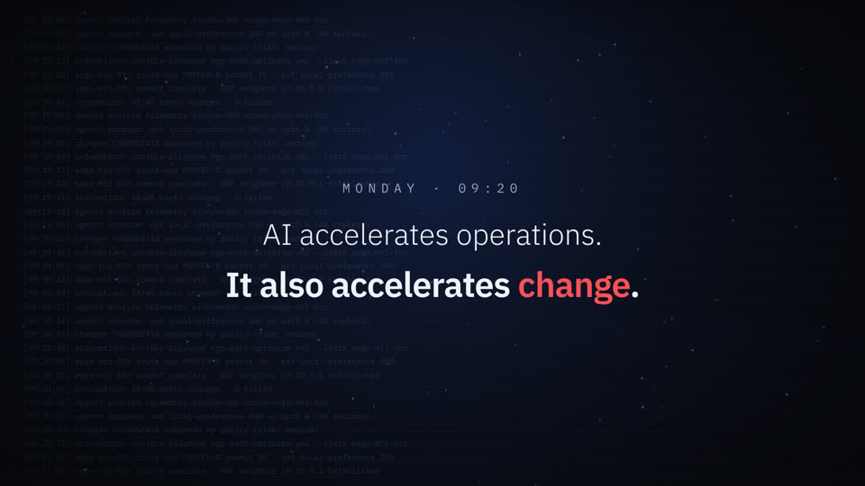

**Purpose:** Hook: AI accelerates operations and change

**Visuals:** Black open. Faint scrolling agent and automation logs behind a centred clock “MONDAY · 09:20”. Typewriter line, then a punch line in red.

**On-screen text:**

- MONDAY · 09:20
- AI accelerates operations.
- It also accelerates change.

**Narration:**

> Nine twenty, Monday morning.
> AI accelerates operations. It also accelerates change.
> And change now happens at machine speed.

**Soundtrack:** Sub drone and single bass impact; typewriter ticks; tension pad enters. Cues: 0:00 impact (1).

### 0:12–0:40 · Critical infrastructure

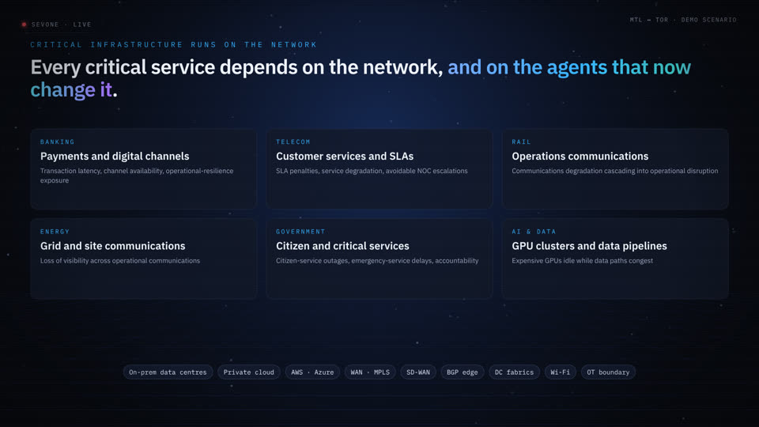

**Purpose:** Six industries, on-prem and cloud, all run on the network

**Visuals:** Six industry tiles fill in (banking, telecom, rail, energy, government, AI & data), then a row of environment chips: on-prem DCs, private cloud, AWS · Azure, WAN · MPLS, SD-WAN, BGP edge, DC fabrics, Wi-Fi, OT boundary.

**On-screen text:**

- Every critical service depends on the network, and on the agents that now change it.

**Narration:**

> Banks, telecom operators, railways, energy utilities, governments and AI platforms all run on the network.
> On premises and in the cloud, across WAN, SD-WAN and data centers.
> AI agents now help engineers troubleshoot, generate configurations and execute changes across that infrastructure.
> That creates enormous opportunity, and a new operational risk.

**Soundtrack:** Pulse bass starts (96 BPM); pad opens up. Cues: 0:12 impact (0.45).

### 0:40–1:08 · Network architecture

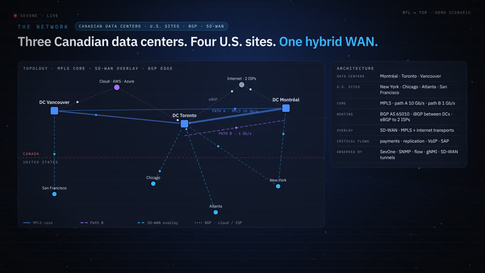

**Purpose:** DCs in Montréal, Toronto, Vancouver; U.S. sites over SD-WAN; BGP and MPLS core

**Visuals:** Topology draws in layers: MPLS core between DC Vancouver, DC Toronto and DC Montréal (path A 10 Gb/s; path B 1 Gb/s drawn parallel in purple), then the SD-WAN overlay to San Francisco, Chicago, Atlanta and New York, then BGP links to cloud and two ISPs. A dashed Canada / United States line separates the DCs from the U.S. sites. An architecture panel lists DCs, sites, core, routing, overlay, critical flows and what SevOne observes.

**On-screen text:**

- Three Canadian data centers. Four U.S. sites. One hybrid WAN.
- PATH A · MPLS 10 Gb/s
- PATH B · 1 Gb/s
- BGP AS 65010 · iBGP between DCs · eBGP to 2 ISPs

**Narration:**

> Here is the network. Data centers in Montreal, Toronto and Vancouver, joined by an MPLS core.
> Path A, ten gigabits, carries payments and replication between Toronto and Montreal. Path B, one gigabit, is the backup.
> New York, Chicago, Atlanta and San Francisco connect over SD-WAN, with BGP to the cloud.
> SevOne sees all of it.

**Soundtrack:** Pulse continues; soft blips as architecture rows appear.

### 1:08–1:40 · Agentic operations, with controls

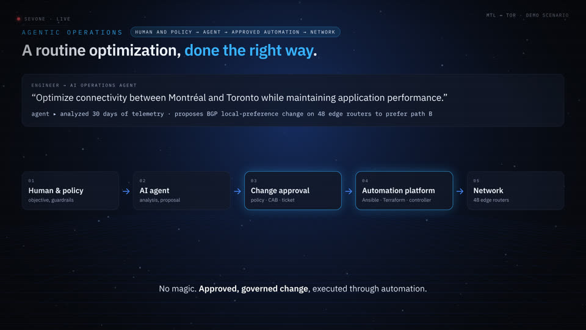

**Purpose:** Human and policy → agent → approved automation → network

**Visuals:** Engineer prompt card; the agent’s proposal types in. A five-step control chain lights up in sequence: Human & policy → AI agent → Change approval → Automation platform → Network (48 edge routers).

**On-screen text:**

- A routine optimization, done the right way.
- “Optimize connectivity between Montréal and Toronto while maintaining application performance.”
- No magic. Approved, governed change, executed through automation.

**Narration:**

> Consider a routine optimization.
> An engineer asks an AI agent to improve connectivity between Montreal and Toronto, without hurting application performance.
> The agent analyzes telemetry, and proposes a BGP preference change on forty-eight edge routers.
> Following change policy, the change is approved, and executed through the automation platform.
> Human and policy, then agent, then approved automation. Exactly as it should be.

**Soundtrack:** Kick drum enters; light hi-hats for a “systems” feel. Cues: 1:08 impact (0.45).

### 1:40–2:14 · AI-built BGP and SD-WAN configuration

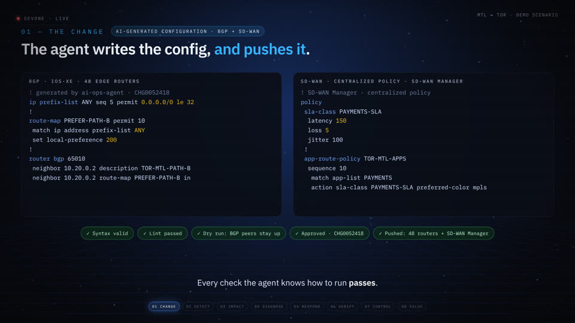

**Purpose:** The agent writes, validates and pushes the configuration

**Visuals:** Two code panels type in line by line: the BGP configuration (prefix-list ANY 0.0.0.0/0 le 32, route-map PREFER-PATH-B setting local-preference 200, applied inbound on the TOR–MTL path B neighbour) and the SD-WAN centralized policy (sla-class PAYMENTS-SLA with latency 150, loss 5; app-route-policy steering PAYMENTS). Five green validation chips follow: syntax, lint, dry run, approval, pushed.

**On-screen text:**

- The agent writes the config, and pushes it.
- ✓ Syntax valid · ✓ Lint passed · ✓ Dry run: BGP peers stay up · ✓ Approved · CHG0052418 · ✓ Pushed: 48 routers + SD-WAN Manager
- Every check the agent knows how to run passes.

**Narration:**

> The agent writes the configuration itself.
> A BGP route-map that raises local preference on path B.
> And an SD-WAN policy, with an SLA class for payment traffic.
> The syntax validates. The BGP peers stay up. The change passes approval.
> It is pushed to forty-eight routers, and to the SD-WAN manager.
> Every check the agent knows how to run, passes.

**Soundtrack:** Typing blips per code line; impact on scene start. Cues: 1:40 impact (0.45).

### 2:14–2:42 · The change

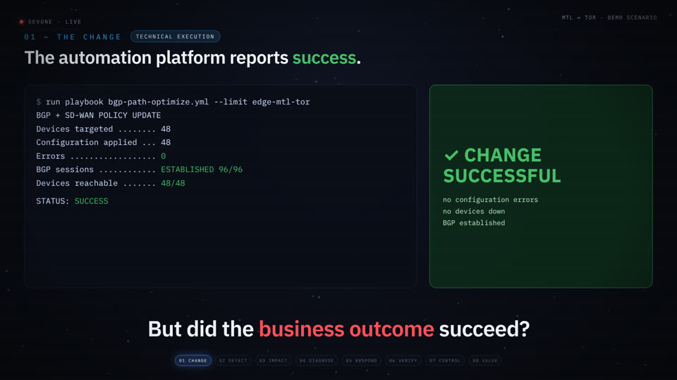

**Purpose:** 48 devices, 0 errors: technical success

**Visuals:** Automation console prints the playbook run line by line: 48 targeted, 48 applied, 0 errors, BGP 96/96 established. A green “CHANGE SUCCESSFUL” card pops. Hold, then the question lands in red.

**On-screen text:**

- STATUS: SUCCESS
- ✓ CHANGE SUCCESSFUL
- But did the business outcome succeed?

**Narration:**

> Forty-eight devices are updated.
> No configuration errors. No devices down. BGP sessions remain established.
> The automation platform reports success.
> But did the business outcome succeed?

**Soundtrack:** Console blips per line; riser into a hard stop; big impact on the question with music drop-out (0:96). Cues: 2:14 impact (0.45); 2:35 riser 3 s; 2:38 impact (1.1).

### 2:42–3:27 · SevOne sees something different

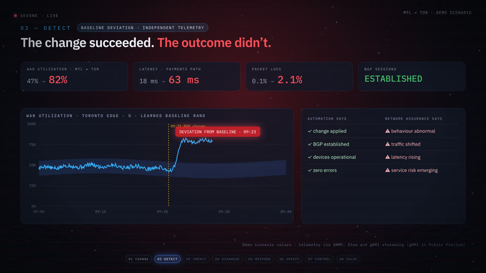

**Purpose:** Baseline deviation while BGP stays established

**Visuals:** Switch to SevOne. Utilization chart draws against the learned baseline band; a red “DEVIATION FROM BASELINE · 09:23” tag pops. KPI tiles count up: 47→82 %, 18→63 ms, 0.1→2.1 %; BGP still ESTABLISHED. Split table: Automation says ✓ vs Network assurance says ⚠.

**On-screen text:**

- The change succeeded. The outcome didn’t.
- DEVIATION FROM BASELINE · 09:23
- Demo scenario values · gNMI in Public Preview

**Narration:**

> Independent network telemetry tells a different story.
> Traffic has shifted onto a more constrained path.
> WAN utilization climbs from forty-seven to eighty-two percent. Latency, from eighteen to sixty-three milliseconds. Packet loss reaches two percent.
> Yet BGP is still established, and every device is still up.
> SevOne compares live behavior with each path's learned baseline, and flags the deviation within minutes.
> This is the critical distinction. Technical success does not guarantee business success.

**Soundtrack:** Alarm tone and impact at the deviation; red tint; heavier kick. Cues: 2:42 impact (0.5); 2:49 riser 2.5 s; 2:52 impact (1); 2:52 alarm tone.

### 3:27–3:57 · Before it becomes an incident

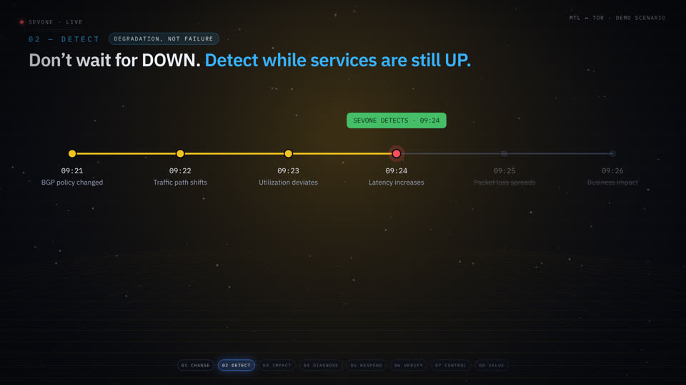

**Purpose:** Detect degradation while services are still up

**Visuals:** Horizontal timeline 09:21 → 09:26. The yellow progress bar stops at 09:24 where a green “SEVONE DETECTS · 09:24” badge appears; 09:25 and 09:26 grey out and are struck through. Four evidence tiles: baselines, flow, telemetry, synthetics.

**On-screen text:**

- Don’t wait for DOWN. Detect while services are still UP.
- SEVONE DETECTS · 09:24

**Narration:**

> This is where observability changes the risk equation.
> Baselines, flow records and streaming telemetry show the degradation while services are still up.
> SevOne raises the condition at nine twenty-four, before packet loss spreads, and before any customer calls.
> Don't wait for down. Detect degradation while services are still up.

**Soundtrack:** Amber tint; music steadies; riser into the industries section. Cues: 3:27 impact (0.45); 3:54 riser 3 s.

### 3:57–4:57 · Six industries, six consequences

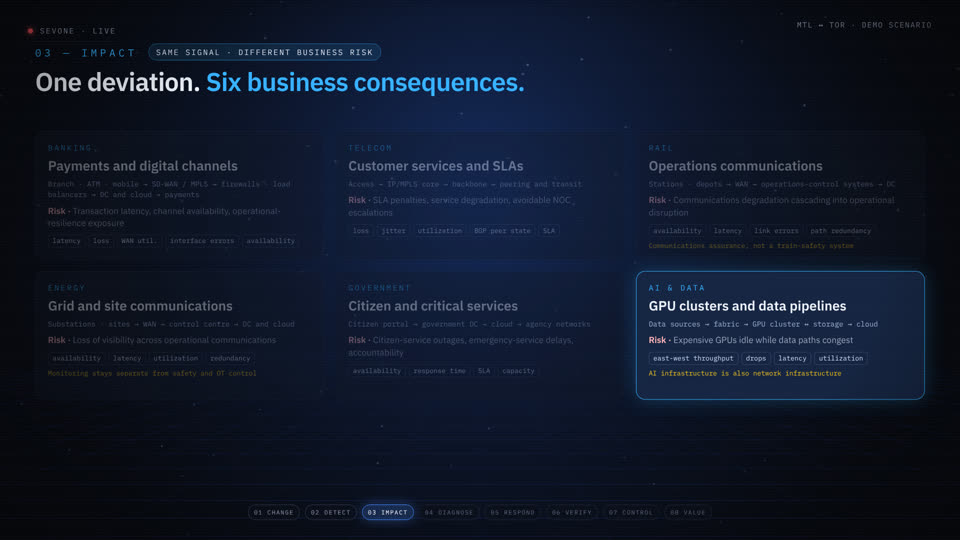

**Purpose:** Same signal, different business risk

**Visuals:** Six industry cards (3 × 2). Each card in turn brightens with a cyan border while the narrator covers it: architecture path, risk, KPI chips, and a guardrail note for rail, energy and AI.

**On-screen text:**

- One deviation. Six business consequences.
- Rail: communications assurance, not a train-safety system
- Energy: monitoring stays separate from safety and OT control
- AI infrastructure is also network infrastructure

**Narration:**

> For a bank, the same deviation becomes transaction latency, and operational-resilience exposure.
> For a telecom operator, it means SLA penalties, and avoidable NOC escalations.
> For rail, communications visibility keeps degradation from cascading into operational disruption.
> For energy, visibility across operational communications stays separate from safety and control systems.
> For government and critical services, it is evidence for availability and accountability.
> And for AI platforms, congested data paths leave expensive GPUs waiting. AI infrastructure is network infrastructure.

**Soundtrack:** Full arrangement; soft blip as each card activates. Cues: 3:54 riser 3 s; 3:57 impact (0.8).

### 4:57–5:42 · Root cause and blast radius

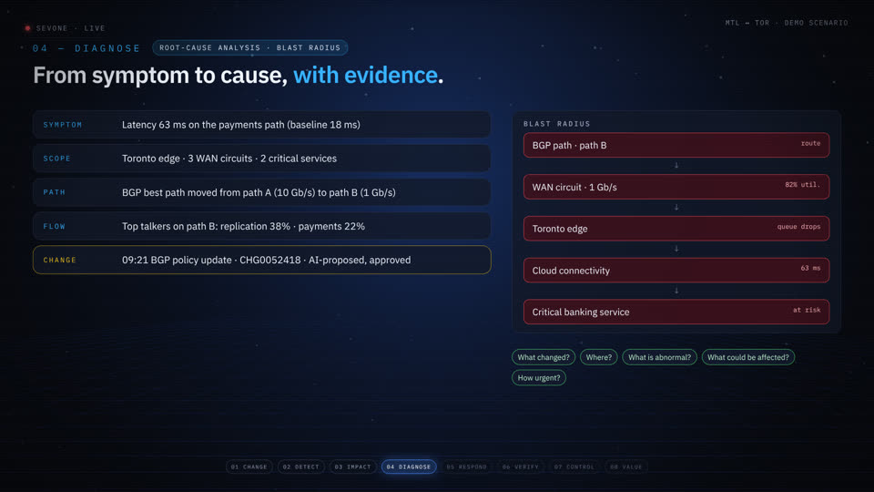

**Purpose:** Symptom → scope → path → flow → change

**Visuals:** Five RCA rows slide in (symptom → scope → path → flow → change). On the right, the blast-radius stack turns red from the BGP path down to the critical banking service; five question chips turn green.

**On-screen text:**

- From symptom to cause, with evidence.
- What changed? Where? What is abnormal? What could be affected? How urgent?

**Narration:**

> Next question: what exactly happened, and where?
> SevOne moves from the symptom, to the scope, to the path, to the flows, and back to the change that caused it.
> Latency on the payments path. Three WAN circuits at the Toronto edge. The BGP best path moved to a one-gigabit circuit.
> Replication and payment flows now share it. The trigger: the nine twenty-one policy change.
> What changed, where, what is abnormal, what could be affected, and how urgent. Answered with evidence, not opinion.

**Soundtrack:** Steady pulse; no impacts, to keep focus on the narration. Cues: 4:57 impact (0.45); 5:39 riser 3 s.

### 5:42–6:26 · What went wrong, explained

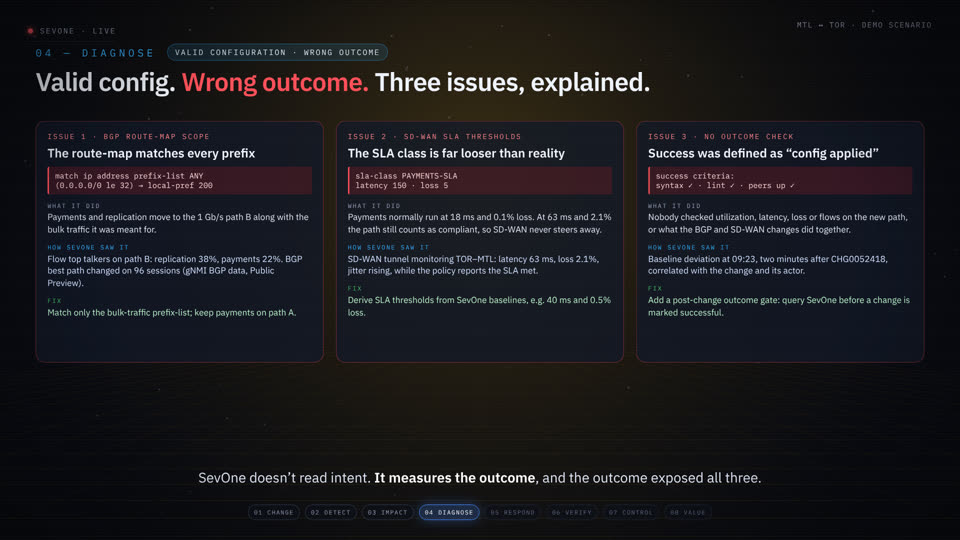

**Purpose:** Three issues: route-map scope, SD-WAN SLA thresholds, no outcome check

**Visuals:** Three issue cards build left to right, each with the offending config line in red, what it did, how SevOne saw it, and the fix: (1) route-map scope matches every prefix; (2) SD-WAN SLA class thresholds far looser than the payments baseline; (3) success defined as “config applied”, no outcome check.

**On-screen text:**

- Valid config. Wrong outcome. Three issues, explained.
- Issue 1 · BGP route-map scope
- Issue 2 · SD-WAN SLA thresholds
- Issue 3 · No outcome check
- SevOne doesn’t read intent. It measures the outcome, and the outcome exposed all three.

**Narration:**

> So what went wrong? Three issues, each one valid on its own.
> One: the route-map matches every prefix, not just bulk traffic. Payments and replication all move to the one-gigabit path.
> Two: the SD-WAN SLA class allows a hundred and fifty milliseconds and five percent loss. The degraded path still looks compliant, so nothing is steered away.
> Three: each change was checked for syntax. None was checked against the outcome.
> SevOne exposed all three: the flows on path B, SD-WAN tunnel latency and loss, and the baseline deviation minutes after the change.

**Soundtrack:** Riser into an impact; amber tint; blip per card. Cues: 5:39 riser 3 s; 5:42 impact (0.7).

### 6:26–7:11 · Incident automation

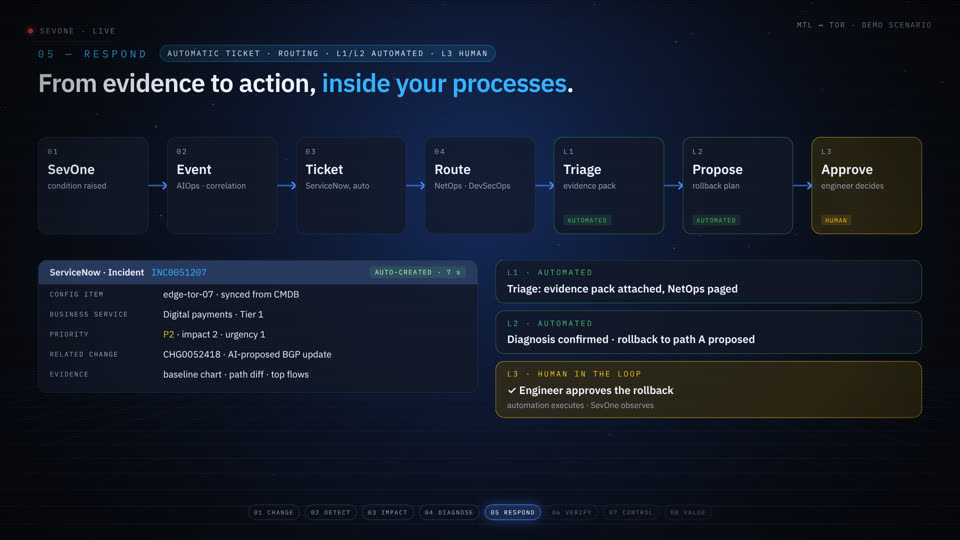

**Purpose:** Event → ServiceNow → routing → L1/L2 auto → L3 human

**Visuals:** Seven-stage pipeline with a travelling pulse: SevOne → Event → Ticket → Route → L1 (auto) → L2 (auto) → L3 (human). A ServiceNow incident card fills in (CI from CMDB, P2, related change, evidence). L1/L2/L3 cards stack on the right, ending with the engineer’s approval.

**On-screen text:**

- From evidence to action, inside your processes.
- INC0051207 · AUTO-CREATED · 7 s
- L3 · human in the loop · automation executes · SevOne observes

**Narration:**

> Detection alone doesn't reduce risk. The insight has to enter your existing processes.
> SevOne raises the event. A ServiceNow incident opens automatically, with the configuration item, the priority and the evidence.
> NetOps is paged. DevSecOps is informed of the AI-initiated change.
> Levels one and two are automated: triage, correlation, and a rollback proposal.
> Level three is human. An engineer approves the rollback.
> The automation platform executes it. SevOne remains the independent observer.

**Soundtrack:** Soft chime when the ticket is created. Cues: 6:26 impact (0.45); 6:47 chime.

### 7:11–7:41 · Verify the outcome

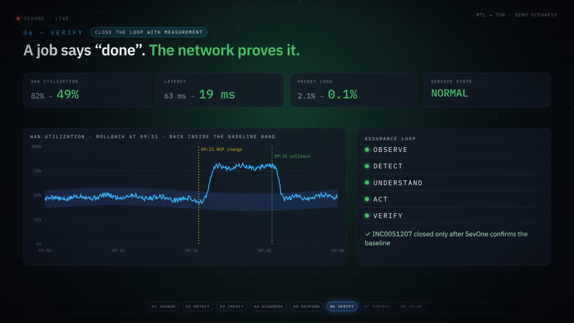

**Purpose:** Re-measure against baseline before closing

**Visuals:** Tiles count back down (82→49 %, 63→19 ms, 2.1→0.1 %), service NORMAL. Chart redraws with the 09:31 rollback back inside the baseline band. The assurance loop lights OBSERVE → DETECT → UNDERSTAND → ACT → VERIFY.

**On-screen text:**

- A job says “done”. The network proves it.
- ✓ INC0051207 closed only after SevOne confirms the baseline

**Narration:**

> And remediation isn't complete because a job reports success. The network is measured again.
> Utilization returns to forty-nine percent. Latency to nineteen milliseconds. Packet loss disappears.
> Only then does the ticket close. Observe, detect, understand, act, and verify.

**Soundtrack:** Resolution chime; green tint. Cues: 7:11 impact (0.6); 7:19 chime.

### 7:41–8:21 · Risk controls

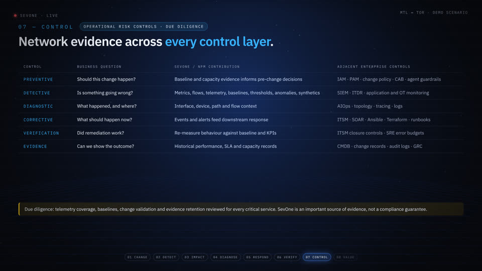

**Purpose:** Preventive → detective → diagnostic → corrective → verification → evidence

**Visuals:** Six-row control table builds row by row: preventive, detective, diagnostic, corrective, verification, evidence; columns for business question, SevOne contribution and adjacent enterprise controls. Due-diligence note at the bottom.

**On-screen text:**

- Network evidence across every control layer.
- SevOne is an important source of evidence, not a compliance guarantee.

**Narration:**

> This is how network evidence supports enterprise risk controls.
> Preventive controls govern what can change. Detective controls surface abnormal behavior.
> Diagnostic evidence explains it. Corrective workflows respond. Verification confirms recovery.
> And the history becomes evidence for audit, regulators, and due diligence.
> SevOne is an important source of that evidence, alongside change, ITSM and security records.
> It doesn't replace those controls. It makes them measurable.

**Soundtrack:** Row blips; even, confident pulse. Cues: 7:41 impact (0.45).

### 8:21–8:51 · Executive risk dashboard

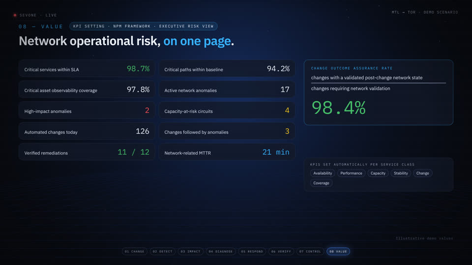

**Purpose:** KPI framework and change outcome assurance rate

**Visuals:** Ten executive KPI tiles (demo values) and the change outcome assurance rate formula counting to 98.4 %. Chips show KPI families set per service class.

**On-screen text:**

- Network operational risk, on one page.
- CHANGE OUTCOME ASSURANCE RATE = validated post-change states ÷ changes requiring validation
- Illustrative demo values

**Narration:**

> Executives get one view of network operational risk.
> KPIs are set per service class: availability, performance, capacity, stability, change and coverage.
> And one new metric for the agentic era: the change outcome assurance rate.
> The share of changes whose network outcome was actually verified.

**Soundtrack:** Pulse continues; slight lift. Cues: 8:21 impact (0.45).

### 8:51–9:36 · TCO and OPEX

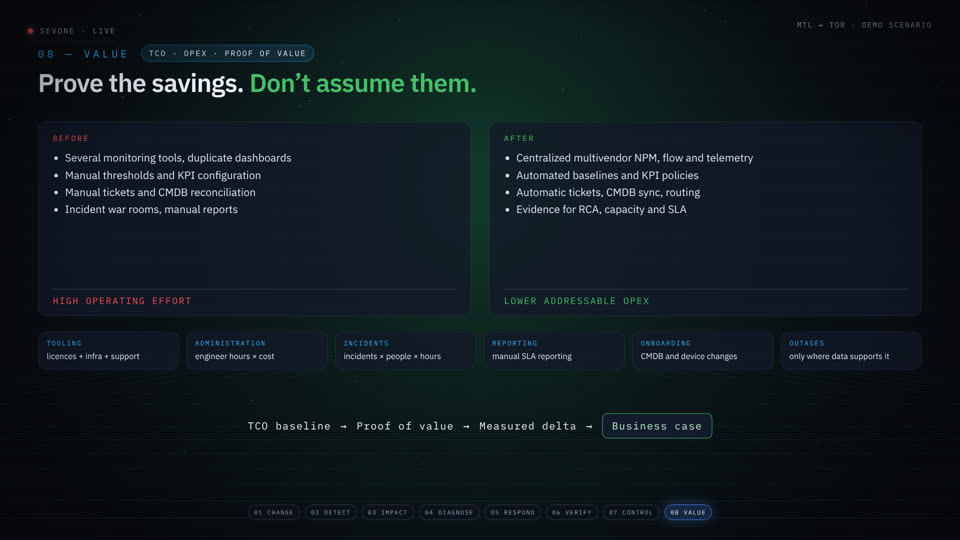

**Purpose:** Measure, don't assume: baseline → PoV → delta → business case

**Visuals:** Before vs After columns, six cost-pool tiles, then a flow: TCO baseline → Proof of value → Measured delta → Business case (green).

**On-screen text:**

- Prove the savings. Don’t assume them.
- TCO baseline → Proof of value → Measured delta → Business case

**Narration:**

> The business case goes beyond avoided outages.
> Consolidated tools, automated baselines, automatic tickets and CMDB sync reduce the effort behind every incident.
> But don't estimate savings from marketing assumptions.
> Baseline today's tooling, administration, incident, reporting and onboarding costs.
> Run a proof of value, measure the delta, and build the business case from evidence.
> That is how you prove lower TCO and OPEX.

**Soundtrack:** Green tint; music begins to resolve. Cues: 8:51 impact (0.45).

### 9:36–9:58 · Three truths

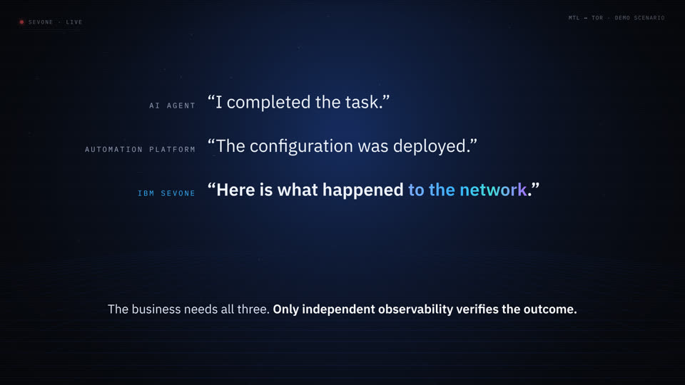

**Purpose:** Agent, automation and SevOne each report a different truth

**Visuals:** Three statements appear one by one, attributed to the AI agent, the automation platform and IBM SevOne, then the conclusion.

**On-screen text:**

- “I completed the task.”
- “The configuration was deployed.”
- “Here is what happened to the network.”
- The business needs all three. Only independent observability verifies the outcome.

**Narration:**

> The AI agent tells you the task was completed.
> The automation platform tells you the change was applied.
> SevOne tells you what happened to the network.
> The business needs all three. Only independent observability verifies the outcome.

**Soundtrack:** Music thins out; riser into the question. Cues: 9:36 impact (0.6); 9:55 riser 3 s.

### 9:58–10:18 · The question

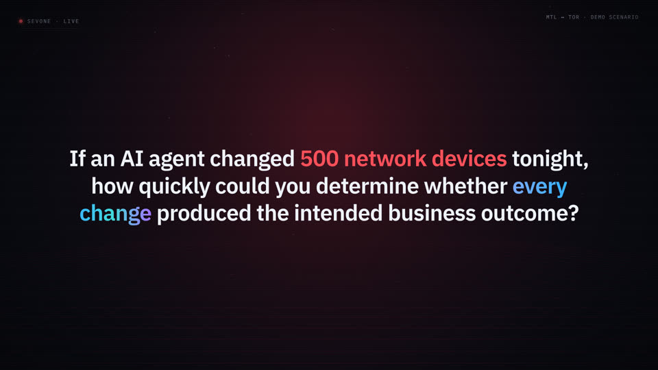

**Purpose:** The 500-device question

**Visuals:** Full-screen question on a red-tinted background, held for the whole scene.

**On-screen text:**

- If an AI agent changed 500 network devices tonight, how quickly could you determine whether every change produced the intended business outcome?

**Narration:**

> If an AI agent changed five hundred network devices tonight, how quickly could you determine whether every change produced the intended business outcome?

**Soundtrack:** Biggest impact of the film, then near silence: drone only. Cues: 9:55 riser 3 s; 9:58 impact (1.2).

### 10:18–10:46 · Next step

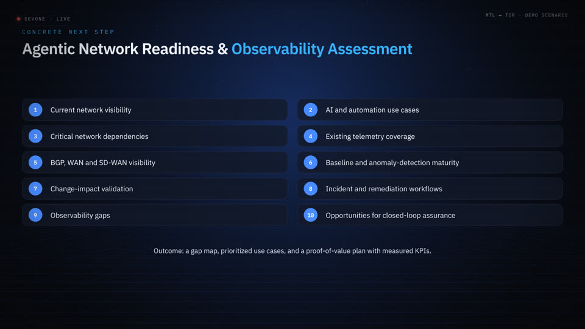

**Purpose:** Agentic Network Readiness & Observability Assessment

**Visuals:** Title, then ten numbered assessment items appear two by two; outcome line at the bottom.

**On-screen text:**

- Agentic Network Readiness & Observability Assessment
- 1–10 assessment areas
- Outcome: a gap map, prioritized use cases, and a proof-of-value plan with measured KPIs.

**Narration:**

> Start with an Agentic Network Readiness and Observability Assessment.
> Visibility, AI use cases, critical dependencies, telemetry coverage, and BGP and WAN visibility.
> Baselines, change-impact validation, incident workflows, observability gaps, and closed-loop assurance.

**Soundtrack:** Pulse returns softly; blip per item. Cues: 10:18 impact (0.6); 10:43 riser 3 s.

### 10:46–11:06 · Closing

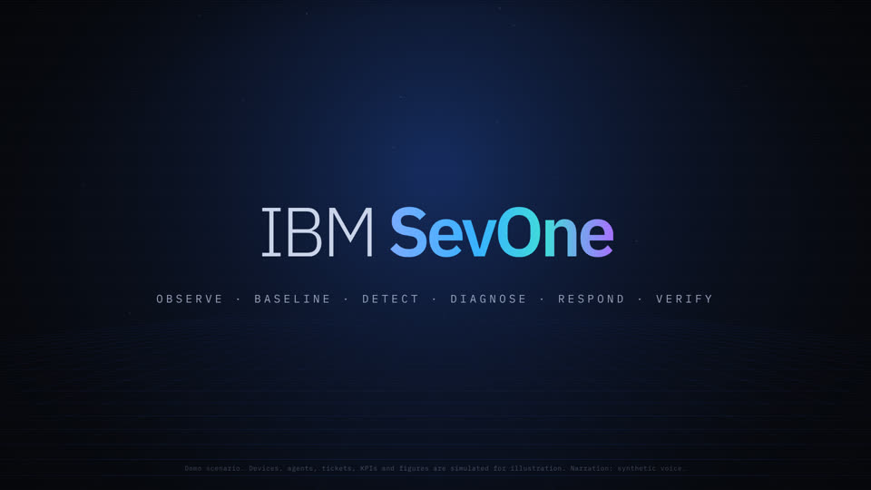

**Purpose:** Autonomy without observability is risk

**Visuals:** Closing lines build one per beat, then clear to the IBM SevOne brand reveal and tagline; disclaimer at the bottom; fade to black.

**On-screen text:**

- In the age of Agentic AI, autonomy without observability is risk.
- The future isn’t just autonomous networking.
- It’s autonomous networking with continuous assurance.
- IBM SevOne · Observe · Baseline · Detect · Diagnose · Respond · Verify

**Narration:**

> In the age of agentic AI, autonomy without observability is risk.
> The future isn't just autonomous networking.
> It's autonomous networking, with continuous assurance.
> IBM SevOne.

**Soundtrack:** Riser, brand-reveal impact, sustained final chord, fade out. Cues: 10:43 riser 3 s; 10:46 impact (0.8); 10:54 riser 3 s; 10:57 impact (1.2).

## Appendix A · Industry risk-control matrices

### Banking

**Architecture:** Branch · mobile · ATM → SD-WAN / MPLS / internet → firewalls, load balancers → core DC, mainframe → hybrid cloud, payments

**Principal risk:** A routing, capacity or connectivity change degrades payments or digital banking while the network is technically “up”.

| Control | Network assurance example |
|---|---|
| Preventive | Change policy plus capacity and SLA assessment |
| Detective | Behavioural baselines: latency, loss, jitter, utilization |
| Corrective | ITSM incident → approved network workflow (reroute, rollback) |
| Verification | Post-change KPIs compared with baseline |
| Evidence | Performance, change and incident records for operational-risk review |

**KPIs:** Availability, transaction-path latency, site-to-DC latency, loss, jitter, BGP peers, interface errors, SD-WAN tunnels, QoS, circuit capacity

**Executive KRI:** % of critical paths outside approved baseline; % of high-risk changes followed by abnormal behaviour within 30 min

### Telecommunications

**Architecture:** Access / 5G / broadband → aggregation → IP/MPLS → backbone → peering and transit → service platforms

**Principal risk:** Customer-service degradation, oversubscribed links, peering instability, SLA breach, capacity exhaustion.

| Control | Network assurance example |
|---|---|
| Preventive | Capacity forecasts, SLA engineering, path validation |
| Detective | BGP, loss, latency, jitter, utilization, flows |
| Corrective | NOC incident and controlled traffic engineering |
| Verification | Utilization, loss and latency verified after remediation |
| Evidence | SLA and historical performance evidence |

**KPIs:** Availability, BGP stability, latency, loss, jitter, utilization, errors, traffic volume, QoS, capacity headroom, SLA compliance

**Executive KRI:** Capacity-at-risk: critical links forecast to exceed the engineering threshold in the planning horizon

### Rail and transportation

**Architecture:** Stations → IP/MPLS / WAN → communications network → operational applications → DC / cloud

**Principal risk:** Communications degradation compounding an operational disruption. (SevOne is network assurance, not signalling or train-control safety.)

| Control | Network assurance example |
|---|---|
| Preventive | Capacity and change assessment for operational communications |
| Detective | WAN loss, latency, jitter, interface degradation |
| Corrective | NOC incident → approved network remediation |
| Verification | Communications-path recovery validated |
| Evidence | Network availability and performance history |

**KPIs:** Station connectivity, WAN availability, MPLS path health, latency, loss, interface errors, circuit utilization, redundant-path health

**Executive KRI:** Critical communications paths outside baseline

### Energy and utilities

**Architecture:** Enterprise IT → network boundary → OT communications → sites, substations, plants

**Principal risk:** Loss of visibility across operational communications. (Not a replacement for protection relays, SCADA safety controls or OT-security platforms.)

| Control | Network assurance example |
|---|---|
| Preventive | Approved network changes, capacity and path planning |
| Detective | Availability, latency, loss, interface anomalies |
| Corrective | Controlled NOC / operations escalation |
| Verification | Network recovery confirmed after remediation |
| Evidence | Network service and SLA history |

**KPIs:** Control-site connectivity, communications-path availability, redundant-path status, WAN/MPLS latency, loss, capacity, route stability

**Executive KRI:** Critical communications links outside normal baseline

### Government and critical services

**Architecture:** Citizen services → agencies, campuses, remote offices → DC → hybrid cloud

**Principal risk:** Critical-service availability, digital-service disruption, remote-site failure, cloud connectivity, accountability.

| Control | Network assurance example |
|---|---|
| Preventive | Change windows, architecture standards, capacity assessment |
| Detective | Network, SLA and baseline monitoring |
| Corrective | Automated incident routing and controlled response |
| Verification | Service and network recovery confirmation |
| Evidence | Historical SLA and performance evidence |

**KPIs:** Latency, loss, availability, capacity, interface health, routing; MTTD, MTTA, MTTR; recurring incidents

**Executive KRI:** Network observability coverage = critical assets monitored ÷ critical assets in scope

### AI and data infrastructure

**Architecture:** Data sources → network fabric → storage + GPUs → AI platform → model and inference services

**Principal risk:** Congestion starving GPU and data workloads; expensive compute waiting on data; change-induced degradation.

| Control | Network assurance example |
|---|---|
| Preventive | Capacity and network architecture planning |
| Detective | Fabric utilization, loss, latency, flow anomalies |
| Corrective | Incident and automation workflow |
| Verification | Traffic and performance normalization confirmed |
| Evidence | Historical network-performance correlation |

**KPIs:** Fabric utilization, loss, latency, saturation, throughput, east-west traffic, storage-network throughput, cloud connectivity, headroom

**Executive KRI:** Idle compute attributable to network constraints

## Appendix B · Universal NPM KPI framework

| Family | Example KPIs |
|---|---|
| Availability | device, interface, path, site, tunnel availability; BGP neighbour state |
| Performance | latency, loss, jitter, throughput, utilization, errors, discards, QoS |
| Traffic | NetFlow/IPFIX volumes, top applications and conversations, traffic shifts, unexpected flows |
| Capacity | peak and 95th-percentile utilization, headroom, growth, saturation risk |
| Service quality | SLA compliance, critical-path health, site and service availability |
| Change and coverage | change outcome assurance rate, observability coverage |

**Change outcome assurance rate** = changes with a validated post-change network state ÷ changes requiring network validation × 100.

**Network observability coverage** = critical network assets monitored ÷ critical network assets in scope × 100.

## Appendix C · Incident automation (L1 / L2 / L3)

| Stage | What happens | Who acts |
|---|---|---|
| Detect | SevOne raises a condition from baseline deviation, thresholds or flow anomalies | Automatic |
| Ticket | ServiceNow incident created with CI (CMDB-synced), priority, related change and evidence | Automatic (integration) |
| Route | NetOps paged, DevSecOps informed of AI-initiated change, service owner notified | Automatic (integration) |
| L1 | Triage and evidence pack | Automated |
| L2 | Diagnosis and rollback proposal | Automated |
| L3 | Rollback or risky change approved by a named engineer; executed by the automation platform | **Human** |
| Verify | SevOne re-measures against baseline; ticket closes only after recovery is confirmed | Automatic |

## Appendix D · Measuring TCO and OPEX

Do not show invented percentages. Baseline six cost pools, run a proof of value, measure the delta:

1. **Tooling:** NPM licences + infrastructure + maintenance + support
2. **Monitoring administration:** engineer hours × loaded labour cost
3. **Incident investigation:** incidents × engineers × hours × labour cost
4. **Reporting and SLA effort:** manual reporting hours × labour cost
5. **CMDB and device onboarding:** device changes × manual effort
6. **Avoidable outage and degradation cost:** only where customer data supports it

**Annual addressable OPEX** = tooling + administration + incident effort + reporting + onboarding. Compare the current-state baseline with the measured PoV state.

## Appendix E · 60-minute webinar run of show

| Time (min) | Topic | Purpose |
|---|---|---|
| 0–5 | The Network Is Becoming Agentic | Establish urgency |
| 5–12 | When AI Operates at Machine Speed | Introduce business risk |
| 12–19 | Why Traditional Monitoring Isn’t Enough | Establish need for assurance |
| 19–27 | SevOne 9.0 Observability Foundation | Introduce technology |
| 27–35 | Agentic Network Assurance | Observe, baseline, detect, anticipate |
| 35–47 | Live BGP Agentic AI Scenario | Prove value (play this film, then go live) |
| 47–52 | Three Control Planes | Establish architecture and boundaries |
| 52–55 | Closed-Loop Network Assurance | Show future operating model |
| 55–58 | Business Value | Translate technical capabilities into outcomes |
| 58–60 | Call to Action | Drive assessment / PoV |

Play this film at the start of the 35–47 minute block (Live BGP Agentic AI Scenario), then switch to the live SevOne demonstration.

## Appendix F · Call to action: Agentic Network Readiness & Observability Assessment

1. Current network visibility
2. AI/automation use cases
3. Critical network dependencies
4. Existing telemetry coverage
5. BGP/WAN/SD-WAN visibility
6. Baseline and anomaly-detection maturity
7. Change-impact validation
8. Incident and remediation workflows
9. Observability gaps
10. Opportunities for closed-loop assurance

**Closing line:** “In the age of Agentic AI, autonomy without observability is risk. The future isn’t just autonomous networking. It’s autonomous networking with continuous assurance.”
